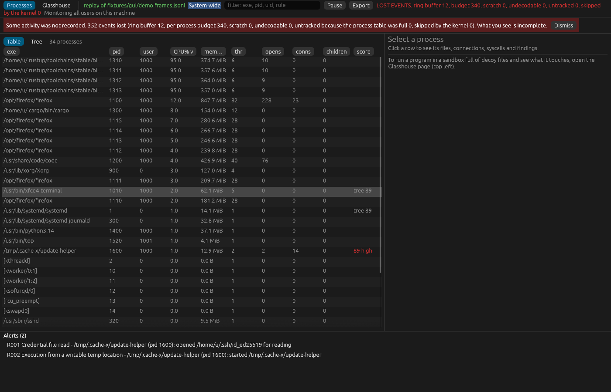
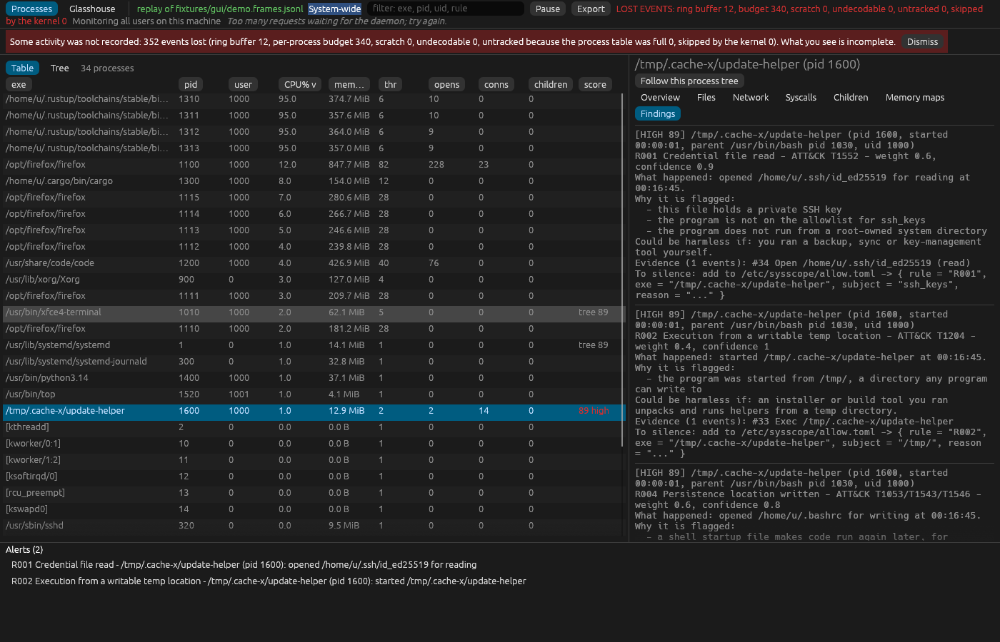
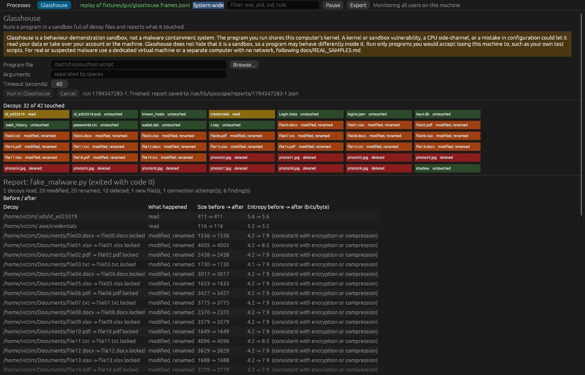

# SysScope

SysScope shows what programs on your Linux machine are doing and explains why
some behaviour looks suspicious. It is a visibility tool with explainable
heuristics, not an antivirus, and it cannot be relied on to stop or contain
malware.



## What it does

| | |
|---|---|
| **Live process view** | Every process with its CPU, memory, threads, files opened, connections and children, updated twice a second. You can see it as a table or as a tree. |
| **Kernel-level tracing** | Programs started, files opened, renamed and deleted, outbound connections and listening sockets, and per-process system-call counts. Captured with eBPF inside the kernel, so it sees what programs do even when they skip the usual libraries. |
| **Explained findings** | Eleven rules for behaviour worth a second look: reading SSH keys or browser passwords, running from a temp folder, running with no file on disk, writing startup files, mass file rewrites (ransomware), regular beaconing to the internet, port scans, event floods, a document viewer starting a shell, attempts to inject into another process, and touching a Glasshouse decoy. An experimental twelfth, "unlike its usual self", is off by default. Each finding says what happened, why it is flagged, what harmless explanation might fit, and lists the exact events behind it. |
| **Follow mode** | Watch one program and everything it starts, with extra detail such as system-call timing, while the rest of the system is ignored. |
| **Glasshouse** | Run a program in a sandbox full of decoy files (fake SSH keys, documents, photos) and get a before/after report of what it read, changed, deleted and tried to connect to. |
| **Honest about gaps** | Events SysScope could not record are counted and shown, never silently dropped. |
| **Private** | Everything stays on the machine. The daemon makes no network connections at all, and exports hide personal details by default. |



## Quickstart (60 seconds)

Download the package for your system from the
[Releases](https://github.com/lu7h9a/sysscope/releases) page. On Debian or
Ubuntu:

```bash
sudo apt-get install -y ./sysscope_0.0.1-1_amd64.deb
sudo systemctl enable --now sysscoped
sudo usermod -aG sysscope,sysscope-act "$USER"
sysscope --version
sudo sysscope status
sudo sysscope top --sort score -n 10
```

After you log out and back in, you can drop the `sudo` and open the desktop app
with `sysscope-gui`.

The package installs the service but never starts it by itself. **The daemon
sees the processes of every user on the computer**, and so does anyone in the
`sysscope` group. Add only people you would show that to.

Other systems:

```text
sudo dnf install ./sysscope-0.0.1-1.x86_64.rpm            # Fedora
makepkg -si                                               # Arch, with the PKGBUILD from the release
tar xf sysscope-0.0.1-x86_64.tar.gz && sudo ./sysscope-0.0.1-x86_64/install.sh   # anything else
```

## Try it

See what a program does in the Glasshouse sandbox:

```bash
printf '#!/bin/sh\ncat ~/.ssh/id_ed25519 > /dev/null\necho hi > ~/Documents/note.txt\n' > try.sh
sudo sysscope glasshouse run try.sh
```

Read the findings so far, each with its explanation:

```bash
sudo sysscope findings
```

Other commands:

```text
sysscope detail PID          files, connections, syscalls and findings of one process
sysscope follow PID          watch only PID and what it starts; sysscope unfollow to stop
sysscope tail                live events
sysscope export --format json > snapshot.json    personal details redacted by default
```

Following needs root or the `sysscope-act` group, because while it is on,
SysScope ignores every other process for everyone.

## Glasshouse



Glasshouse is a behaviour-demonstration sandbox, not a malware containment system. The program you run shares this computer's kernel. A kernel or sandbox vulnerability, a CPU side-channel, or a mistake in configuration could let it read your data or take over your account or the machine. Glasshouse does not hide that it is a sandbox, so a program may behave differently inside it. Run only programs you would accept losing this machine to, such as your own test scripts. For real or suspected malware use a dedicated virtual machine or a separate computer with no network, following docs/REAL_SAMPLES.md.

Glasshouse needs bubblewrap. On Ubuntu 24.04 the default AppArmor policy
blocks the user namespaces it uses, so SysScope reports it as unavailable
there and says why. SysScope does not change that setting.

## How it works

```text
            your desktop                                   root
  +-------------------------+                 +--------------------------------+
  | sysscope-gui / sysscope |  Unix socket    | sysscoped                      |
  | (unprivileged)          | <-------------> |  rules + scoring (sysscope-core)|
  +-------------------------+  group sysscope |  process table, history        |
                                              |  /proc sampler (1 Hz)          |
                                              +---------------^----------------+
                                                              | ring buffer
                                              +---------------+----------------+
                                              | kernel: eBPF probes            |
                                              |  exec, fork, exit, file open,  |
                                              |  rename, unlink, connect,      |
                                              |  listen, ptrace, syscall counts|
                                              +--------------------------------+
  Glasshouse: sysscoped -> systemd transient unit -> bubblewrap sandbox
              (decoy home, no network, seccomp) -> differ -> report
```

The kernel probes only observe; they never change what programs do. The
daemon runs as a hardened systemd service with five Linux capabilities and no
network access. The desktop app and CLI run as you and talk to it only over
the socket. More detail: [docs/ARCHITECTURE.md](docs/ARCHITECTURE.md).

## Requirements

- Linux 5.15 or newer with BTF type information. Every supported
  distribution ships it.
- systemd, and bubblewrap for Glasshouse.
- Tested on Debian 12, Ubuntu 22.04, Ubuntu 24.04, Fedora 45 and Arch:
  [docs/COMPAT.md](docs/COMPAT.md).

## Limitations

SysScope is a visibility tool. It does not block anything, and a determined
attacker with root can hide from it. It does not see inbound connections or
attempts the kernel refused, and its rules are heuristics that will sometimes
flag harmless programs and miss harmful ones. The full list is in
[docs/LIMITATIONS.md](docs/LIMITATIONS.md).

## Documentation

| | |
|---|---|
| [docs/ARCHITECTURE.md](docs/ARCHITECTURE.md) | How the parts fit together |
| [docs/THREAT_MODEL.md](docs/THREAT_MODEL.md) | What is protected, who can do what, remaining risks |
| [docs/PRIVACY.md](docs/PRIVACY.md) | What is collected, where it goes, who can see it |
| [docs/LIMITATIONS.md](docs/LIMITATIONS.md) | What SysScope cannot see or do |
| [docs/REAL_SAMPLES.md](docs/REAL_SAMPLES.md) | Studying real malware safely, in a separate VM |
| [docs/DEMO.md](docs/DEMO.md) | A 60-second demo |
| [docs/COMPAT.md](docs/COMPAT.md), [docs/BENCH.md](docs/BENCH.md), [docs/FP_REPORT.md](docs/FP_REPORT.md) | Test results: distributions, overhead, false positives |
| [SECURITY.md](SECURITY.md) | Reporting a vulnerability |
| [CHANGELOG.md](CHANGELOG.md) | Release history |

## Configuration

The rules and the allowlist are built in. To change them, edit the files in
`/etc/sysscope/`; each one explains its format. Then restart the daemon with
`sudo systemctl restart sysscoped`. Clients cannot change the rules.

## Remove

```bash
sudo apt-get purge -y sysscope
```

`remove` keeps `/etc/sysscope`; `purge` deletes it too. For the tarball, run
`sudo ./uninstall.sh` (add `--purge` to remove `/etc/sysscope` as well).

## Building from source

```text
make setup        # build dependencies (Debian/Ubuntu/Kali)
make release      # target/release/{sysscoped,sysscope,sysscope-gui,sysscope-glasshouse}
make test         # unprivileged tests
make test-root    # kernel tests (needs root; best inside a VM)
make package      # all packages, built in an Ubuntu 22.04 VM
```

## How this was built

SysScope was built with heavy AI assistance. The design and the verification
approach are documented in `docs/`: every kernel change is tested in virtual
machines first, results are recorded with the commands that produced them,
and independent reviews hunted for bugs and security holes before release.
What has not been verified is listed openly in
[docs/UNVERIFIED.md](docs/UNVERIFIED.md).

## License

MIT, see [LICENSE](LICENSE). The eBPF programs are dual MIT/GPL.
